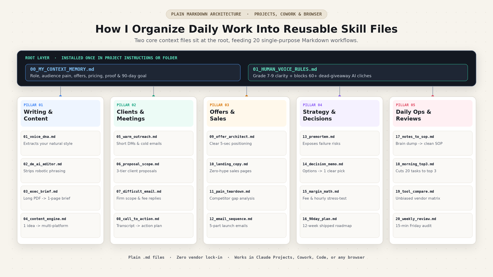
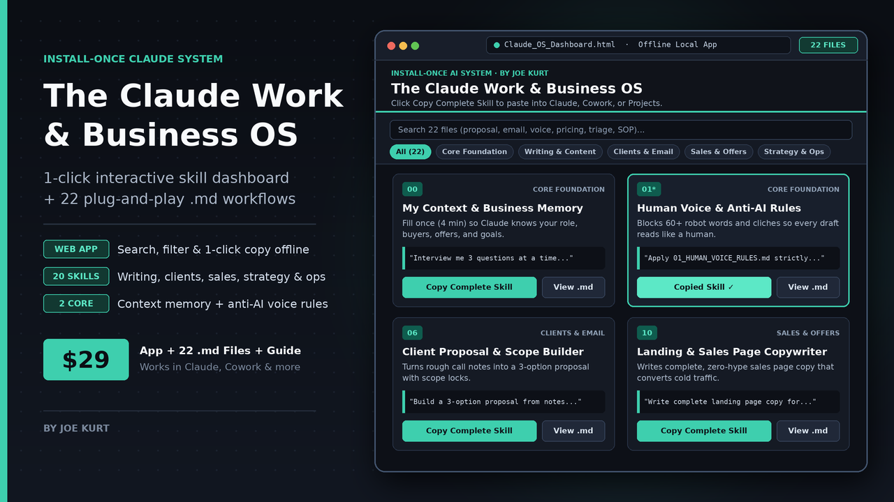

# Claude Work & Business Skills (Starter Pack)

**3 free, install-once `SKILL.md` workflows for client proposals, call recaps, and pre-mortem stress tests in Claude Projects, Claude Cowork, and Claude Code.**



Most people keep a messy spreadsheet of 100+ prompts they never open, then waste 20 back-and-forth messages (and burn their 5-hour Claude usage limit) fixing stiff, generic drafts.

This starter repository gives you **3 single-purpose `SKILL.md` workflow files** you can install once and run every week for real client and business work.

---

## Quick Install (1 Command)

### Option A: `npx skills` CLI (Claude Code, Cursor, Codex, Windsurf)
```bash
npx skills add joekurt120/claude-work-skills
```

### Option B: Claude Projects or Claude Cowork (No Terminal Needed)
1. Open the [`skills/`](./skills) folder above and download any `SKILL.md` file.
2. Drag it into **Claude Projects** (*Project Knowledge*) or your **Claude Cowork** skills panel.
3. Paste your rough call bullets or plan and run it in 1 turn.

---

## 3 Free Skills Included in This Starter Repo

| Skill Folder | Daily Job It Solves | Output Returned in 1 Turn |
| :--- | :--- | :--- |
| [`client-proposal-scope-builder`](./skills/client-proposal-scope-builder/SKILL.md) | Turn messy discovery call bullets into a persuasive client proposal | 3 priced options (`1x` Core, `1.5x` Complete, `2.2x` Fast-Track) + explicit scope boundaries + cover email |
| [`meeting-transcript-to-action`](./skills/meeting-transcript-to-action/SKILL.md) | Extract real decisions and hidden client signals from any call | 3-bullet summary + 4-column owner/deadline table + between-the-lines risks + recap email |
| [`premortem-blindspot-finder`](./skills/premortem-blindspot-finder/SKILL.md) | Stress-test a launch, hire, or pricing move before spending cash or weeks | Ranked failure table + unproven assumptions + 1 cheap 48-hour validation test |

---

## Want the Complete 22-File System + 1-Click Browser App?



This GitHub repo holds 3 starter skills. If you want the complete daily system already built and organized across all 5 areas of online work, grab **[The Claude Work & Business OS ($29 one-time)](https://livefree1.gumroad.com/l/chpvtb?utm_source=github)**:

| Included | Starter Repo (Free) | Full Claude Work & Business OS ($29) |
| :--- | :---: | :---: |
| **Client Proposal, Call Action Plan & Pre-Mortem (`SKILL.md`)** | Yes (3 skills) | **All 20 `SKILL.md` Workflows** |
| **`00_MY_CONTEXT_MEMORY.md`** *(4-min interview so Claude remembers your offers, proof & goals)* | - | **Included** |
| **`01_HUMAN_VOICE_RULES.md`** *(blocks 60+ dead-giveaway AI clichés automatically)* | - | **Included** |
| **Writing & Content Pillar** *(Voice DNA Extractor, De-AI Editor, Exec Brief, Multi-Platform Engine)* | - | **Included (4 skills)** |
| **Sales & Offers Pillar** *(Offer Architect, Landing Page Copy, Buyer-Pain Teardown, 5-Email Launch)* | - | **Included (4 skills)** |
| **Strategy & Daily Ops** *(Decision Memo, Margin Math, 90-Day Plan, Notes->SOP, Morning Top-3, Weekly Review)* | - | **Included (9 more skills)** |
| **`Claude_OS_Dashboard.html`** *(1-Click Offline Search & Copy Web App for Claude, ChatGPT & Gemini)* | - | **Included** |
| **26-Page Master PDF Guide** *(1 skill per page, clean setup walkthrough)* | - | **Included** |

- **Get the Complete OS ($29):** [https://livefree1.gumroad.com/l/chpvtb](https://livefree1.gumroad.com/l/chpvtb?utm_source=github)
- **Shipping a new offer this week?** Grab the free **[48-Hour Launch Checklist ($0+)](https://livefree1.gumroad.com/?utm_source=github)**

---

## License

The 3 starter skills in this repository are released under the [MIT License](./LICENSE). Built by **Joe Kurt** ([@heyjoekurt](https://heyjoekurt.medium.com)).
